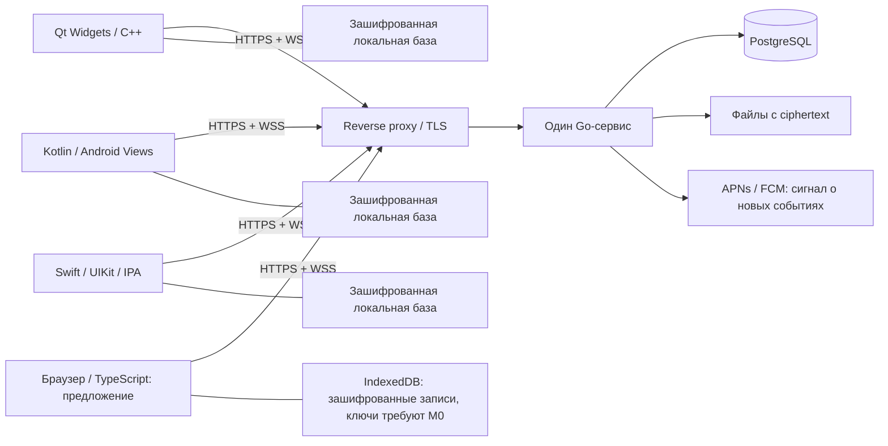

# Архитектура

Статус: предложение v0.2, веб добавлен 2026-10-19. Цель — один понятный путь доставки и минимальное число постоянно работающих компонентов. Работающих клиентов и сервера пока нет.

## Общая схема



Сервер знает аккаунты, устройства, участников и время/размер доставки. Текст, имена файлов, подписи изображений и ключи вложений находятся внутри E2EE-payload. Наличие E2EE не скрывает всю метаинформацию.

## Клиенты

### Desktop

C++20, CMake, Qt 6: Core, Gui, Widgets, Network, WebSockets, Sql. SVG используется при необходимости; не тащить Quick, WebEngine и Multimedia ради одного экрана.

Список чатов и таймлайн — `QListView` + `QAbstractListModel` + `QStyledItemDelegate`, постраничная загрузка и ограниченный кэш. Не создавать отдельный QWidget на каждое сообщение. Переменная высота сообщений рассчитывается с кэшем раскладки; `uniformItemSizes` допустим только для действительно одинаковых элементов.

UI-поток занимается вводом и отображением. Локальная база и криптосессии работают через сериализованный worker с собственным соединением БД; сеть асинхронна. Между потоками передаются неизменяемые результаты. Криптосессия одного собеседника не изменяется параллельно двумя задачами.

### Android

Kotlin, Android Views/XML, RecyclerView, ViewModel, coroutines/Flow, Room, OkHttp. SQLCipher-совместимый драйвер выбирается на M0. По умолчанию один app-модуль с пакетами по обязанностям; не создавать десятки Gradle-модулей заранее.

WebSocket — пока приложение активно; FCM — для фонового уведомления. Сборка без Google services возможна позднее, но не получает обещания мгновенных фоновых уведомлений. Постоянный foreground service не является штатным способом доставки v1.

### iOS

Swift, UIKit, UICollectionView, URLSession; SQLite/SQLCipher через небольшой слой доступа. Приложение выдаётся как IPA. Scarlet — способ установки и подписи, а не отдельный runtime и не фреймворк UI. Детали и проверка push находятся в [документе iOS](07-ios-scarlet.md).

### Веб

Предложение — TypeScript + Vite, DOM/CSS и ограниченные списки, без обязательного UI-фреймворка. Node нужен для инструментов сборки; сервер приложения остаётся Go. Статические ресурсы и API желательно отдавать с одного origin. Браузерный UI не заменяет Qt и не становится WebView внутри нативных клиентов.

Веб-история и outbox — зашифрованные записи IndexedDB; crypto worker не блокирует ввод. Браузерная криптобиблиотека, защита ключей и координация вкладок ещё не выбраны. Node add-on libsignal не считается готовым браузерным SDK. Подробности: [веб-клиент](10-web-client.md).

### Что общее

Общие: wire-контракт, E2EE-формат, тест-векторы, правила состояний, дизайн-токены. Нативные экраны, жизненный цикл, хранилище ключей и кэш остаются платформенными. Не встраивать Go runtime в клиенты ради повторного использования нескольких DTO.

Кандидат E2EE — libsignal с Java/Swift API и небольшим Qt C ABI bridge к его Rust-реализации. Поддержка внешних проектов не обещана поставщиком, bridge нестабилен, лицензия AGPLv3; это **проверка M0**, а не уже готовая интеграция. Rust здесь — возможная зависимость библиотеки, не отдельный собственный клиентский стек.

## Go-сервис

Один процесс и один deployable: `net/http`, драйвер PostgreSQL, небольшая WebSocket-библиотека и фоновые worker-задачи внутри процесса. Точные версии и библиотеки фиксируются при создании кода после проверки поддержки и лицензий.

Обязанности пакетов:

- `auth`: приглашения, Argon2id, сессии и восстановление аккаунта.
- `devices`: подтверждённые устройства, подписанные списки устройств, публичные prekeys, отзыв.
- `conversations`: личные диалоги, группы, ревизии состава и права.
- `messages`: проверка адресатов, идемпотентность, атомарное сохранение ciphertext.
- `sync`: долговечная лента событий устройства, курсоры, WS-подсказки.
- `attachments`: квоты, потоковая загрузка зашифрованных объектов, очистка.
- `push`: APNs/FCM, ограниченные повторы, удаление недействительных токенов.

Это пакеты, а не отдельные сервисы. SQL-запросы явные, с миграциями; ORM и собственная DI-платформа не требуются. Публикация WS/push начинается после commit; задания push сохраняются в той же БД, поэтому падение процесса не теряет намерение отправить уведомление.

## Хранение на сервере

PostgreSQL — источник истины для `users`, `devices`, `device_rosters`, `sessions`, `prekeys`, `conversations`, `memberships`, `messages`, `envelopes`, `device_events`, `attachments`, `push_jobs`.

- `messages`: один логический message_id, conversation_id, seq и idempotency fingerprint.
- `envelopes`: отдельный ciphertext для каждого допустимого устройства-получателя.
- `device_events`: события устройства с последовательным commit-safe cursor; не обычный глобальный SERIAL.
- `attachments`: owner, случайный object_id, ciphertext-size, ciphertext-hash, срок хранения и привязка к сообщению.
- `sessions`: только хеши случайных access/refresh tokens; отзыв привязан к устройству.

Файлы лежат в отдельном закрытом каталоге, выдаются через авторизованный обработчик, а не как общедоступная директория reverse proxy. Нельзя построить путь из пользовательского имени файла. Сначала ограниченный временный файл, проверка длины/хеша, atomic rename, затем состояние ready. Объект ready привязывается к сообщению в транзакции send.

На старте достаточно локального диска. Переход к объектному хранилищу выполняется при измеренной необходимости; зашифрованный формат объекта и API при этом сохраняются.

## Локальное хранилище

На нативных клиентах SQLite-совместимая зашифрованная база хранит историю, криптосессии, полученные event_id, cursor и outbox. Проектный вариант — SQLCipher. Проверять наличие реального cipher backend; успешный `PRAGMA key` на обычной SQLite не доказывает шифрование. Веб использует отдельный адаптер IndexedDB с теми же требованиями к атомарности crypto state/outbox и без хранения открытых сообщений. Ключ базы нельзя переносить в localStorage ради одинакового интерфейса хранилища.

Ключ базы защищается DPAPI на Windows, Keychain на Apple-платформах, Android Keystore на Android; для Linux — Secret Service. Если секретное хранилище недоступно, нельзя молча записывать ключ открытым текстом. E2EE защищает передачу и серверное хранение; локальная база после разблокировки доступна самому приложению.

## Развёртывание

Предложение: Debian, отдельный системный пользователь `neochat`, systemd, один reverse proxy, PostgreSQL на loopback, закрытый каталог данных и внешние зашифрованные backups. Приложение работает без root и без `sudo`. Административный пользователь `ivan` не является runtime-пользователем сервиса.

Публичны HTTPS/443 и при необходимости HTTP/80 для TLS/redirect. Для SSH без VPN сначала ограничить адреса, если это удобно владельцу; наличие VPN не является условием запуска продукта. Никаких изменений текущего сервера этот документ не выполняет.

## Будущая структура кода

```text
apps/desktop/          # CMake / C++ / Qt
apps/android/          # Gradle / Kotlin
apps/ios/              # Xcode / Swift
apps/web/              # предложены TypeScript / Vite; пока не создан
server/cmd/neochat/    # entrypoint
server/internal/      # пакеты монолита
server/migrations/    # PostgreSQL
contracts/            # опубликованный API и тест-векторы после M0
infra/                # systemd, proxy, backup/restore
docs/                 # продукт, решения и дизайн
```

Это план дерева, а не существующие компоненты. Не создавать пустые реализации ради соответствия схеме.
