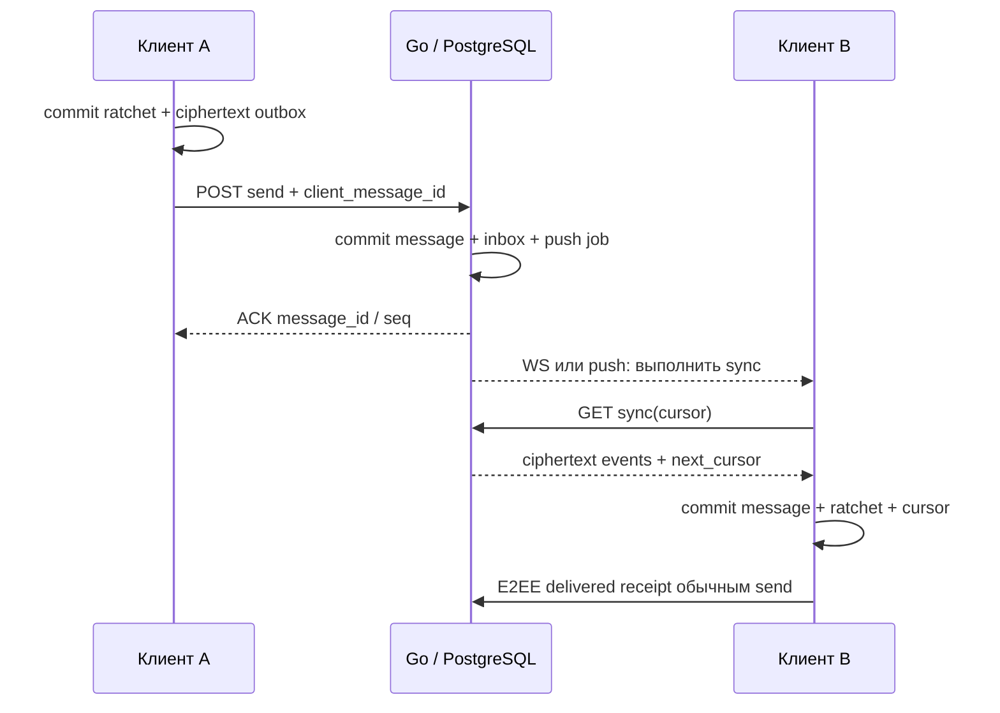

# Протокол v1 и согласованность

Веб-клиент добавлен в проектирование и использует тот же send/sync/envelope-контракт. Браузерные сессии и хранилище требуют адаптера из [плана веб-клиента](10-web-client.md). Cookie-auth ещё не реализован; серверное расшифрование не допускается.

Статус: проект контракта. До реализации криптографический payload и правила подписей уточняются на M0; HTTP-доставка не зависит от выбранного cipher suite.

## Транспорт и идентификаторы

HTTPS JSON — команды, sync и метаданные файлов. WSS — только короткое `sync.required`, без отдельного пути принятия сообщений. После подсказки клиент запускает обычный sync; потеря WS или push не теряет сообщение. При подключении, возвращении в foreground и восстановлении сети sync выполняется независимо от подсказок.

Access token передаётся в `Authorization: Bearer`, для WSS — в заголовке handshake нативного клиента. Токены не передаются в URL. TLS проверяется штатным trust store, отключение проверки сертификата запрещено. Сжатие WebSocket в v1 выключено.

Все ID — случайные UUIDv4. Сервер выводит user_id и sender_device_id из сессии, а не из полей клиента. Счётчики и ревизии передаются десятичными строками, чтобы не терять точность 64-битных значений. Серверное время — RFC 3339 UTC; порядок задаётся seq, а не часами телефона.

## Набор операций

- `POST /v1/accounts`: приглашение, username, парольная фраза, публичные ключи первого устройства и первичный подписанный roster. Возвращает сессию и одноразовый recovery code.
- `POST /v1/sessions`: проверка пароля. Известное устройство доказывает владение ключом; новое получает только ограниченную pending-сессию для привязки.
- `POST /v1/sessions/refresh`, `DELETE /v1/sessions/current`: ротация refresh token / выход.
- `GET /v1/devices`, `POST /v1/devices/link`, `POST /v1/devices/{id}/approve`, `DELETE /v1/devices/{id}`: ограниченный QR-flow, подтверждение основным устройством, отзыв. Пароль сам по себе не добавляет доверенное устройство.
- `POST /v1/accounts/recover`: одноразовый recovery code, новый пароль и новые ключи; отзывает все старые сессии, повышает identity epoch и создаёт отдельное событие смены личности.
- `POST /v1/contacts/resolve`: точный username, ограничение частоты; нет listing endpoint.
- `GET /v1/users/{id}/devices`: подписанный roster для доступного контакта/участника.
- `POST /v1/devices/prekeys`, `POST /v1/devices/{id}/prekeys/claim`: публикация своим устройством и атомарное получение bundle собеседника. One-time prekey выдаётся только один раз; без session/contact/group-доступа claim запрещён.
- `POST /v1/conversations/direct`: создаёт или возвращает единственный диалог данной пары аккаунтов.
- `POST /v1/conversations/groups`: создаёт группу и подписанную ревизию состава; приглашение доставляется через существующие E2EE-сессии.
- `POST /v1/conversations/{id}/membership`: новая подписанная ревизия состава от владельца. `POST /v1/conversations/{id}/leave`: подписанный собственным доверенным устройством выход участника; он может удалить только свой аккаунт. Сервер атомарно публикует переход и отзывает доступ, присутствие владельца для выхода не требуется.
- `POST /v1/conversations/{id}/messages`: атомарный send по схеме [send.schema.json](protocol/send.schema.json).
- `GET /v1/sync?cursor=...&limit=100`: долговечные события текущего устройства.
- `POST /v1/attachments`: резервирование upload_id, квоты и допустимой ciphertext-size.
- `PUT /v1/attachments/{id}/content`: ограниченный поток ciphertext с Content-Length и хешем; повтор одинакового завершённого upload идемпотентен.
- `GET /v1/attachments/{id}/content`: получение разрешённым устройством; без публичной ссылки и без адреса из имени файла.
- `PUT /v1/devices/current/push`: токен, provider и APNs environment только собственного устройства; повтор — upsert.
- `GET /v1/events`: WSS upgrade, затем `{"type":"sync.required","head":"42"}`; push несёт только повод выполнить sync.

Это эскиз API, не OpenAPI и не готовый сервер. Полные DTO аутентификации и key bundles фиксируются после crypto spike; не придумывать несовместимые платформенные варианты.

## Отправка и повтор

1. Клиент проверяет подписанный состав группы и rosters устройств, включая собственные другие устройства.
2. Создаёт client_message_id и E2EE-payload: логический тип, текст/файл/receipt, conversation_id, group revision, roster hash, sender и client_message_id. Эти значения криптографически связываются с ciphertext, проверяются после расшифрования и сопоставляются с внешним маршрутом.
3. Шифрует отдельно каждому доверенному устройству. Атомарно сохраняет новое ratchet-состояние и полный неизменяемый запрос в outbox. При сбое записи ничего не отправляет.
4. Сервер проверяет сессию, активность устройства, членство, актуальность recipient set и наличие ровно одного envelope для каждого нужного устройства. Отправляющее устройство исключено из списка, собственные остальные — включены.
5. В одной транзакции сохраняет message, envelopes, события inbox и push jobs. Возвращает ACK **после commit**.
6. Получатель атомарно сохраняет расшифрованный результат, ratchet-состояние, event_id и cursor. Только затем может отправить E2EE-receipt «доставлено».

Уникальность: `(sender_device_id, client_message_id)`. Повтор **того же сохранённого запроса** возвращает прежний ACK. Другой body с тем же ID — `409 idempotency_conflict`. ACK содержит `message_id`, `client_message_id`, `conversation_seq` и `accepted_at`.

Если HTTP-ответ потерян, клиент сначала повторяет тот же body. Он не шифрует сообщение заново при сетевом retry. Только явный `409 recipient_set_changed`/`409 conversation_revision_changed`, гарантированно без commit, разрешает пересобрать запрос после получения и проверки новых rosters. Изменившиеся ключи нельзя принимать автоматически.

## Ревизии и небольшие группы

V1 использует pairwise fanout: до 16 участников × 3 устройства = 48 устройств, максимум 47 envelopes на send. Sender Keys, MLS и большие группы не внедряются одновременно с первым запуском. Криптобиблиотека выполняет стандартные pairwise-сессии, прикладной слой управляет маршрутизацией и проверяемым составом группы.

Создание группы требует минимум двух аккаунтов. Если после выхода остальных остался только владелец без других устройств, история доступна, а новый send возвращает `409 no_recipients`; пустой recipient set не превращается в успешную доставку.

`conversation_revision` увеличивается при смене состава группы. `recipient_set_revision` — SHA-256 канонического набора допущенных устройств/ревизий roster; это защита от гонки, **не доказательство доверия серверу**. Клиент отдельно проверяет подписи владельца и rosters аккаунтов.

Владелец группы — один аккаунт; добавление и исключение других участников подписывает его основное устройство. Самостоятельный выход подписывает доверенное устройство выходящего аккаунта; такой переход может только удалить этот аккаунт. Все переходы используют проверку предыдущей ревизии и атомарный compare-and-swap. При конфликте клиент получает актуальный проверенный state и повторно подтверждает допустимый переход. Доверенный group state содержит group_id, предыдущий hash, revision, owner identity и список участников. Представление подписываемых данных, domain separation и проверки переходов фиксируются тест-векторами M0 и проходят отдельный security review. Саму подпись предоставляет проверенная библиотека.

Вступление не даёт старую историю. После исключения сервер запрещает новые send/sync/download в этой группе; оставшиеся отправители обновляют recipient set. Уже полученные сообщения, ключи и скачанные файлы отозвать технически невозможно. Потеря account identity владельца замораживает добавление и исключение других участников; для управления клиент предлагает создать новую группу после перепроверки новых ключей. Автоматического переноса владения в v1 нет. Выход владельца архивирует группу для новых отправок, предварительно предупреждая его об этом; остальные сохраняют историю.

## Транзакции, порядок и курсор

- Серверные send, revoke, изменения rosters и membership сериализуются транзакциями PostgreSQL с проверкой актуального состояния. Serialization failure/deadlock повторяется ограниченно; исчерпание попыток возвращает retryable ошибку до ACK.
- conversation_seq и номера событий каждого device inbox выдаются транзакционным увеличением соответствующего head, с блокировками в одинаковом порядке. Обычный `nextval()` не подходит: выдача номера раньше commit может создать пропуск при конкурентном sync.
- Событие устройства содержит event_id, device_seq и вид события. Отсортированный batch возвращает только committed события и cursor последнего включённого события.
- Cursor непрозрачен для клиента, привязан к device_id и incarnation ленты. Клиент сохраняет его только вместе с обработкой всех предшествующих событий.
- Повторный batch безопасен по event_id. Неизвестное, повреждённое или нерасшифровываемое событие сохраняется как диагностируемое состояние до продвижения cursor; ciphertext не выбрасывается молча. Новые криптоключи не подменяются автоматически.
- Истечение cursor: `410 cursor_expired` с процедурой bootstrap без обещания вернуть удалённые ciphertext. После restore БД меняется incarnation и возвращается `409 sync_reset_required`, затем выполняется восстановление по актуальным ключам.
- Отзыв устройства сначала коммитится, затем разрывает его WS; каждый sync/download всё равно повторно проверяет доступ. Нельзя полагаться только на закрытие соединения.

## Файлы

Клиент шифрует файл до upload с помощью потокового AEAD из проверенной библиотеки. Случайный ключ файла и параметры расшифрования передаются только внутри E2EE-сообщения. Сервер хранит ciphertext-hash, но не plaintext-hash и не исходное имя.

Лимит исходного файла 25 MiB; ciphertext ограничен 26 MiB с учётом framing. Чтение, шифрование, загрузка и скачивание потоковые с отменой. Повторная отправка использует сохранённый ciphertext-файл, не переиспользует nonce для изменённых данных. Криптографический framing и поведение при усечении/перестановке chunks утверждаются на M0.

После upload сервер переводит объект в ready, после успешного send — в attached. Непривязанные объекты удаляются через 24 часа. Attached-объекты и серверные envelopes хранятся 30 дней; локальная история остаётся до очистки пользователем. В UI у файла показан срок доступности на сервере. Новому устройству старые вложения автоматически не выдаются.

Зашифрованный файл нельзя надёжно сканировать антивирусом на сервере. Клиент не запускает вложения автоматически, проверяет форматы и размеры, не загружает внешние ресурсы из сообщений и не делает сетевые link previews в v1.

## Лимиты и ошибки

HTTP send body ≤ 1 MiB; envelope decoded ≤ 8192 байт; текст ≤ 4096 байт UTF-8; sync до 100 событий и 1 MiB на batch, что наступит раньше. Поток файла не входит в JSON.

Ответ ошибки содержит `code`, безопасный `message`, `request_id` и при необходимости `retry_after_ms`. Используются 400/401/403/404/409/410/413/429/503; приватные объекты для посторонних возвращают 404. Ретраи только для сетевых ошибок, 429 и временных 5xx, с ограниченным exponential backoff и jitter.

Переполнение WS send queue закрывает медленное соединение с необходимостью повторного sync, а не накапливает бесконечную RAM. «На сервере» означает committed ACK, «доставлено» — подтверждение хотя бы одного допущенного устройства адресата. Для группы UI показывает количество подтвердивших аккаунтов, без утверждения, что прочитали все.
