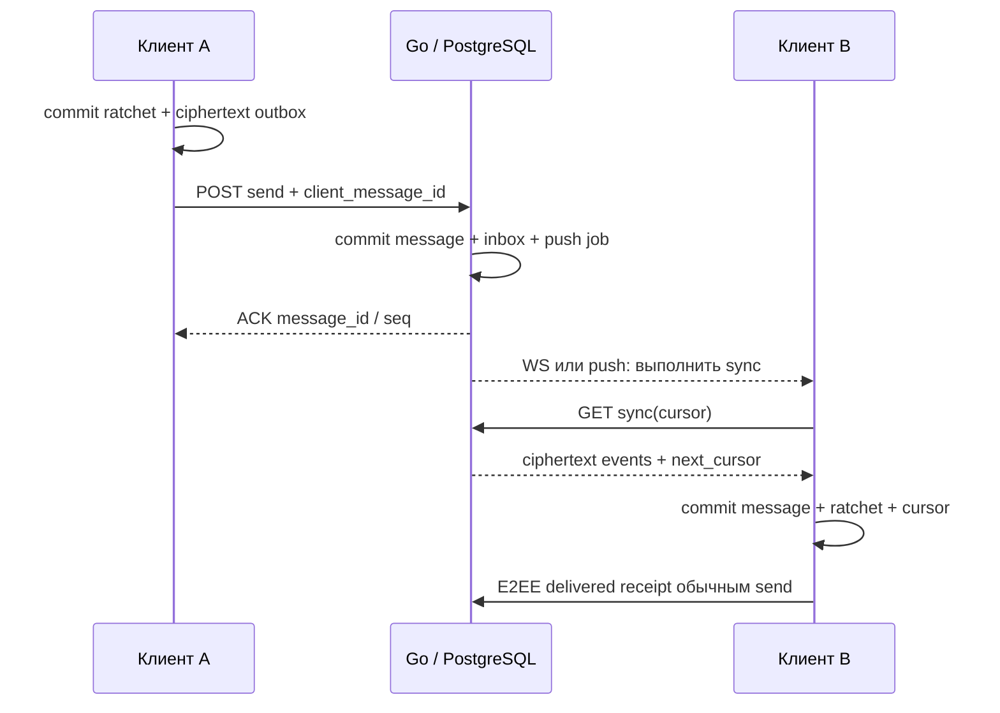

# Протокол v1 и согласованность

Веб-клиент добавлен в проектирование и использует тот же send/sync/envelope-контракт. Браузерные сессии и хранилище требуют адаптера из [плана веб-клиента](10-web-client.md). Cookie-auth ещё не реализован; серверное расшифрование не допускается.

Статус: проект контракта. До реализации криптографический payload и правила подписей уточняются на M0; HTTP-доставка не зависит от выбранного cipher suite.

## Транспорт и идентификаторы

HTTPS JSON — команды, sync и метаданные файлов. WSS — только короткое `sync.required`, без отдельного пути принятия сообщений. После подсказки клиент запускает обычный sync; потеря WS или push не теряет сообщение. При подключении, возвращении в foreground и восстановлении сети sync выполняется независимо от подсказок.

Access token передаётся в `Authorization: Bearer`, для WSS — в заголовке handshake нативного клиента. Токены не передаются в URL. TLS проверяется штатным trust store, отключение проверки сертификата запрещено. Сжатие WebSocket в v1 выключено.

Все ID — случайные UUIDv4. Сервер выводит user_id и sender_device_id из сессии, а не из полей клиента. Счётчики и ревизии передаются десятичными строками, чтобы не терять точность 64-битных значений. Серверное время — RFC 3339 UTC; порядок задаётся seq, а не часами телефона.

## Набор операций

- `POST /v1/accounts`: никнейм (регистр сохраняется для показа, поиск и уникальность — без учёта регистра), имя (display_name, 1–64 символа), пароль, публичные ключи первого устройства и первичный подписанный roster. Возвращает сессию и одноразовый recovery code.
- `POST /v1/sessions`: вход известного устройства. Оно передаёт `auth` из пароля и подпись своим ключом.
- `POST /v1/devices/new/start`, `POST /v1/devices/new/finish`: вход нового устройства по паролю. Start проверяет `auth` и код 2FA (ответ `code_required`, если код нужен) и возвращает `key_backup`, ключ аккаунта, roster и одноразовый start_token на 5 минут. Finish принимает устройство и подписанный им roster и возвращает сессию.
- `POST /v1/devices/qr`, `GET /v1/devices/qr/{id}` (заголовок `X-Link-Secret`), `GET /v1/devices/qr/{id}/device`, `POST /v1/devices/qr/{id}/approve`: вход компьютера по QR-коду, подтверждённый телефоном. Approve сохраняет roster и `sealed` — ключи, зашифрованные секретом из QR.
- `GET/PUT /v1/accounts/current/settings` (`two_factor`), `GET/PUT /v1/accounts/current/history`: настройки аккаунта и непрозрачная зашифрованная копия переписки.
- `GET/PUT /v1/accounts/current/state` (0.6.3): общее состояние своих устройств, непрозрачный blob до 512 КиБ с ревизией (см. ниже).
- `PUT /v1/accounts/current/profile` (`display_name`): смена имени; связанные пользователи получают событие `profile`. Профиль пользователя содержит `username` (как набран), `display_name` и числовой `number` (с 100001).
- Событие `notice` (`{"text"}`) кладёт сообщение в системный чат «NeoChat уведомления».
- `POST /v1/sessions/refresh`, `DELETE /v1/sessions/current`: ротация refresh token / выход.
- `GET /v1/devices`, `DELETE /v1/devices/{id}`: список и отзыв (с новым подписанным roster).
- `POST /v1/accounts/recover`: одноразовый recovery code, новый пароль и новые ключи; отзывает все старые сессии, повышает identity epoch и создаёт отдельное событие смены личности.
- `POST /v1/contacts/resolve`: точный username, ограничение частоты; нет listing endpoint.
- `GET /v1/users/{id}/devices`: подписанный roster для доступного контакта/участника.
- `POST /v1/devices/prekeys`, `POST /v1/devices/{id}/prekeys/claim`: публикация своим устройством и атомарное получение bundle собеседника. One-time prekey выдаётся только один раз; без session/contact/group-доступа claim запрещён.
- `POST /v1/conversations/direct`: создаёт или возвращает единственный диалог данной пары аккаунтов.
- `POST /v1/conversations/groups`: создаёт группу (`kind: "group"`) или канал (`kind: "channel"`) и подписанную ревизию состава; приглашение доставляется через существующие E2EE-сессии.
- `POST /v1/conversations/{id}/membership`: новая подписанная ревизия состава от владельца или админа (правила ниже).
- `GET /v1/conversations/{id}/states`: все подписанные ревизии состава по порядку; клиент проверяет по ним цепочку до текущей.
- `PUT /v1/conversations/{id}/settings` (`members_can_send`, `members_can_media`, `members_can_polls`, `members_can_info`): права участников группы; меняют владелец и админы. `POST /v1/conversations/{id}/leave`: подписанный собственным доверенным устройством выход участника; он может удалить только свой аккаунт. Сервер атомарно публикует переход и отзывает доступ, присутствие владельца для выхода не требуется.
- `POST /v1/conversations/{id}/messages`: атомарный send по схеме [send.schema.json](protocol/send.schema.json).
- `GET /v1/sync?cursor=...&limit=100`: долговечные события текущего устройства.
- `POST /v1/attachments`: резервирование upload_id, квоты и допустимой ciphertext-size.
- `PUT /v1/attachments/{id}/content`: ограниченный поток ciphertext с Content-Length и хешем; повтор одинакового завершённого upload идемпотентен.
- `GET /v1/attachments/{id}/content`: получение разрешённым устройством; без публичной ссылки и без адреса из имени файла.
- `PUT /v1/devices/current/push`: токен, provider и APNs environment только собственного устройства; повтор — upsert.
- `POST /v1/presence` (`user_ids`, до 200): статус только для пользователей из своего круга (контакты, общие беседы). Ответ `{"presence":[{"user_id","status","last_seen"}]}`, где status — `online`, `exact` (точное время), `recently` (до 7 дней) или `long`. Кто скрыл время визита (`show_last_seen: false` в настройках аккаунта), видит у других только «недавно»/«давно», как в Telegram. Подключение по WSS считается «в сети»; при отключении сервер записывает `last_seen` и рассылает событие `presence`.
- `POST /v1/conversations/{id}/typing`: подсказка «печатает»; сервер пересылает подключённым устройствам остальных участников событие `{"type":"typing","conversation_id","user_id"}` без сохранения. Ядро шлёт её не чаще раза в 4 с, клиент гасит подпись через 6 с или при новом сообщении. В каналах не рассылается.
- В профиле (`PUT /v1/accounts/current/profile`) есть `bio` — описание до 100 символов, видно своему кругу.
- `GET /v1/events`: WSS upgrade, затем `{"type":"sync.required","head":"42"}`; push несёт только повод выполнить sync. С `?mode=background` соединение получает те же подсказки, но не отмечает пользователя «в сети» (фоновая служба Android).
- `GET /v1/calls/ice`: `{"ice_servers":[{"urls":[…],"username","credential"}],"ttl"}` — временные учётные данные TURN текущего устройства (TURN REST API, до 60 запросов в час). Без настроенного TURN список пуст.
- Звонки не имеют своего серверного API: E2EE-payload `call` личного диалога несёт `{"op":"offer|answer|hangup|reject|busy|media","id","sdp?","video?","to?"}`, где `to` — устройство собеседника, принявшее или предложившее звонок. Предложение старше 60 с только записывается как пропущенный звонок.

Это эскиз API, не OpenAPI и не готовый сервер. Полные DTO аутентификации и key bundles фиксируются после crypto spike; не придумывать несовместимые платформенные варианты.

## Отправка и повтор

1. Клиент проверяет подписанный состав группы и rosters устройств, включая собственные другие устройства.
2. Создаёт client_message_id и E2EE-payload: логический тип, текст/файл/receipt, conversation_id, group revision, roster hash, sender и client_message_id. Эти значения криптографически связываются с ciphertext, проверяются после расшифрования и сопоставляются с внешним маршрутом.
3. Шифрует отдельно каждому доверенному устройству. Атомарно сохраняет новое ratchet-состояние и полный неизменяемый запрос в outbox. При сбое записи ничего не отправляет.
4. Сервер проверяет сессию, активность устройства, членство, актуальность recipient set и наличие ровно одного envelope для каждого нужного устройства. Отправляющее устройство исключено из списка, собственные остальные — включены.
5. В одной транзакции сохраняет message, envelopes, события inbox и push jobs. Возвращает ACK **после commit**.
6. Получатель атомарно сохраняет расшифрованный результат, ratchet-состояние, event_id и cursor. Только затем может отправить E2EE-receipt «доставлено».

Уникальность: `(sender_device_id, client_message_id)`. Повтор **того же сохранённого запроса** возвращает прежний ACK. Другой body с тем же ID — `409 idempotency_conflict`. ACK содержит `message_id`, `client_message_id`, `conversation_seq` и `accepted_at`.

Если HTTP-ответ потерян, клиент сначала повторяет тот же body. Он не шифрует сообщение заново при сетевом retry. Только явный `409 recipient_set_changed`/`409 conversation_revision_changed`, гарантированно без commit, разрешает пересобрать запрос после получения и проверки новых rosters. Изменившиеся ключи нельзя принимать автоматически.

## Ревизии и небольшие группы

V1 использует pairwise fanout: до 16 участников × 10 устройств = 160 устройств, максимум 159 envelopes на send в небольшой группе. Сервер принимает до 1999 envelopes (каналы до 200 подписчиков × 10 устройств, без отправителя). Sender Keys, MLS и большие группы не внедряются одновременно с первым запуском. Криптобиблиотека выполняет стандартные pairwise-сессии, прикладной слой управляет маршрутизацией и проверяемым составом группы.

Создание группы требует минимум двух аккаунтов. Если после выхода остальных остался только владелец без других устройств, история доступна, а новый send возвращает `409 no_recipients`; пустой recipient set не превращается в успешную доставку.

`conversation_revision` увеличивается при смене состава группы. `recipient_set_revision` — SHA-256 канонического набора допущенных устройств/ревизий roster; это защита от гонки, **не доказательство доверия серверу**. Клиент отдельно проверяет подписи владельца и rosters аккаунтов.

Владелец группы — один аккаунт; добавление и исключение других участников подписывает любое его устройство ключом аккаунта. Самостоятельный выход подписывает доверенное устройство выходящего аккаунта; такой переход может только удалить этот аккаунт. Все переходы используют проверку предыдущей ревизии и атомарный compare-and-swap. При конфликте клиент получает актуальный проверенный state и повторно подтверждает допустимый переход. Доверенный group state содержит group_id, предыдущий hash, revision, owner identity и список участников. Представление подписываемых данных, domain separation и проверки переходов фиксируются тест-векторами M0 и проходят отдельный security review. Саму подпись предоставляет проверенная библиотека.

Вступление не даёт старую историю. После исключения сервер запрещает новые send/sync/download в этой группе; оставшиеся отправители обновляют recipient set. Уже полученные сообщения, ключи и скачанные файлы отозвать технически невозможно. Потеря account identity владельца замораживает добавление и исключение других участников; для управления клиент предлагает создать новую группу после перепроверки новых ключей. Автоматического переноса владения в v1 нет. Выход владельца архивирует группу для новых отправок, предварительно предупреждая его об этом; остальные сохраняют историю.

## Админы, каналы, опросы

Подписанный state v2 (домен `NeoChat-group-v2\0`) содержит group_id, revision, prev_hash, owner_id, signer_id, признак канала, участников и админов; state v1 по-прежнему читается. Владелец подписывает любой переход. Админ предыдущей ревизии может подписать следующую, но не может менять список админов, исключать владельца или других админов. Владелец и признак канала не меняются. Сервер хранит все ревизии в `group_states`.

Канал — не группа: публикуют только владелец и админы, подписчики читают и голосуют, отчётов о прочтении нет. Лимиты: группа до 50 участников, канал до 200.

Название, описание и теги участников передаются E2EE-сообщениями `group_update`. Правка своего сообщения — служебное E2EE-сообщение `edit` (идентификатор, новый текст); получатель применяет его только если отправитель совпадает с автором и заменяет текст, оставляя пометку «изменено». Опрос — сообщение `kind: "poll"` (вопрос в тексте, варианты, `multiple`, `anonymous`), голоса и закрытие — служебные `poll_vote` и `poll_close`. В запросе send есть флаг `control` для служебных сообщений (отчёты, голоса, `group_update`). Обычные сообщения сервер отклоняет от подписчиков канала и от участников группы, где `members_can_send` выключен. Клиенты дополнительно отбрасывают содержимое от отправителей без права.

Реакция — служебное E2EE-сообщение `reaction` (`{"id","emoji"}`, пустой emoji снимает реакцию), одна реакция на пользователя. Ядро отдаёт у сообщения `reactions` (`emoji`, `count`, `mine`, `names`) и `emoji_only` (1–3 эмодзи без текста — клиенты рисуют крупно).

Архив и закреп (до 3 бесед) хранятся в базе ядра (`set_archived`, `set_pinned`). С 0.6.3 они, как и контакты, переходят на другие свои устройства через общее состояние аккаунта (ниже); серверу смысл не виден. QR-код профиля несёт ссылку `neochat://u/<username>?k=<отпечаток ключа>`; `add_contact_qr` находит пользователя, сверяет отпечаток с полученным roster и при совпадении помечает ключ сверенным.

В 0.6.2 метод `clear_conversation` (`conversation_id`, необязательный `hide`) очищает историю, черновик и непрочитанные на текущем устройстве; `hide: true` также убирает чат из списков и снимает закрепление. Членство, криптосессии и очередь отправки сохраняются. Идентификаторы удалённых сообщений остаются локальными tombstone, чтобы повторная доставка не вернула очищенную историю. Новое сообщение или явное `open_direct` возвращает скрытый чат. Клиенты получают `history_cleared` и сбрасывают открытую историю, включая старые незавершённые запросы страницы. Это не удаление у всех и не выход из группы.

### Общее состояние своих устройств (0.6.3)

Контакты (добавление, удаление, своё имя контакта, отметка о сверке кода и закреплённый ключ аккаунта), закреп и архив бесед, а также настройки аккаунта (`quick_reaction`, `read_receipts`) образуют документ `{ключ: {"v": значение, "at": мс}}`. Ключи: `contact:<user_id>`, `chat:<conversation_id>`, `pref:quick_reaction`, `pref:read_receipts`. Документ шифруется XChaCha20-Poly1305 ключом `HKDF(backup_key, "neochat-state-v1")`; `backup_key` есть на каждом своём устройстве (из пароля или в запечатанном виде при входе по QR).

- `GET /v1/accounts/current/state` → `{"revision", "blob"}` или 404.
- `PUT /v1/accounts/current/state` с `{"revision": прочитанная, "blob"}` записывает только при совпадении ревизии; иначе 409 `state_conflict`, клиент перечитывает и сливает заново. `"0"` создаёт документ. Остальные устройства получают событие `state`.
- Слияние по каждой записи: побеждает более позднее `at`, при равном — большее значение, так что устройства сходятся к одному результату. Локальные таблицы остаются источником: изменение переписывает свою запись из таблицы и помечает её к отправке.
- Установки до 0.6.3 при первом слиянии публикуют свои контакты, закрепы и архив с ранним временем, чтобы реальные изменения с других устройств их перекрывали.
- Новый для устройства контакт добавляется с ключом, который закрепило другое своё устройство; сервер затем выдаёт только roster и профиль, а несовпадение ключа показывается как смена ключа. Принятие нового ключа на одном устройстве применяется на остальных, если они уже видят этот же новый ключ.
- Закреп для ещё неизвестной беседы применяется после её появления: получение новой беседы запускает повторное чтение документа.
- Восстановление аккаунта по коду удаляет документ (ключ копии сменился); после смены ключа нечитаемый документ перезаписывается локальным состоянием.

Очистка истории и скрытие беседы по-прежнему действуют только на текущем устройстве. Оформление (тема, размер текста), уведомления, Enter для отправки, устройства звонков и вход по биометрии тоже остаются настройками устройства.

Ядро отправляет клиентам событие `settings_changed`, когда меняются настройки аккаунта. `get_settings` возвращает `quick_reaction` (по умолчанию ❤️), `set_settings` принимает `quick_reaction` (одно эмодзи) и `read_receipts`.

`whats_new` (`version`, `platform`) возвращает `{"show", "title", "items"}` с заметками выпуска из ядра; `whats_new_seen` запоминает показ. Вход на устройстве отмечает текущую версию как просмотренную, поэтому окно появляется только после обновления.

Фото профиля в 0.6.2 загружается бинарным телом `PUT /v1/accounts/current/avatar`; `DELETE` по тому же пути удаляет фото. JPEG до 48 КиБ и 512×512 хранится отдельным файлом; JSON пользователя содержит только `avatar_id` (UUID, пустая строка без фото). `GET /v1/users/{id}/avatar/{avatar_id}` возвращает JPEG после проверки авторизации и доступа к профилю; прежний ID после замены недоступен. Клиенты готовят квадрат 256×256 вне UI-потока. Ядро передаёт файл потоком и сохраняет полученный JPEG в локальный кэш, UI получает `avatar_path` / `sender_avatar_path`. Сервер проверяет размер и декодирование, заменяет ID в транзакции, удаляет прежний файл и рассылает событие `profile`. Фото относится к метаданным профиля, как имя и описание; в сообщения оно не добавляется и схему E2EE не меняет. Миграция `0006_avatar.sql` добавляет поле ID файла.

Сообщение несёт markdown как обычный текст; ядро разбирает его в `spans` (`bold`, `italic`, `strike`, `code`, `pre`, `link`), клиенты рисуют одинаково. У фото в метаданных файла есть `thumb` (маленький JPEG в base64 внутри E2EE-сообщения), `w` и `h`.

## Транзакции, порядок и курсор

- Серверные send, revoke, изменения rosters и membership сериализуются транзакциями PostgreSQL с проверкой актуального состояния. Serialization failure/deadlock повторяется ограниченно; исчерпание попыток возвращает retryable ошибку до ACK.
- conversation_seq и номера событий каждого device inbox выдаются транзакционным увеличением соответствующего head, с блокировками в одинаковом порядке. Обычный `nextval()` не подходит: выдача номера раньше commit может создать пропуск при конкурентном sync.
- Событие устройства содержит event_id, device_seq и вид события. Отсортированный batch возвращает только committed события и cursor последнего включённого события.
- Cursor непрозрачен для клиента, привязан к device_id и incarnation ленты. Клиент сохраняет его только вместе с обработкой всех предшествующих событий.
- Повторный batch безопасен по event_id. Неизвестное, повреждённое или нерасшифровываемое событие сохраняется как диагностируемое состояние до продвижения cursor; ciphertext не выбрасывается молча. Новые криптоключи не подменяются автоматически.
- Истечение cursor: `410 cursor_expired` с процедурой bootstrap без обещания вернуть удалённые ciphertext. После restore БД меняется incarnation и возвращается `409 sync_reset_required`, затем выполняется восстановление по актуальным ключам.
- Отзыв устройства сначала коммитится, затем разрывает его WS; каждый sync/download всё равно повторно проверяет доступ. Нельзя полагаться только на закрытие соединения.

## Файлы

Клиент шифрует файл до upload с помощью потокового AEAD из проверенной библиотеки. Случайный ключ файла и параметры расшифрования передаются только внутри E2EE-сообщения. Сервер хранит ciphertext-hash, но не plaintext-hash и не исходное имя.

Лимит исходного файла 25 MiB; ciphertext ограничен 26 MiB с учётом framing. Чтение, шифрование, загрузка и скачивание потоковые с отменой. Повторная отправка использует сохранённый ciphertext-файл, не переиспользует nonce для изменённых данных. Криптографический framing и поведение при усечении/перестановке chunks утверждаются на M0.

После upload сервер переводит объект в ready, после успешного send — в attached. Непривязанные объекты удаляются через 24 часа. Attached-объекты и серверные envelopes хранятся 30 дней; локальная история остаётся до очистки пользователем. В UI у файла показан срок доступности на сервере. Новому устройству старые вложения автоматически не выдаются.

Зашифрованный файл нельзя надёжно сканировать антивирусом на сервере. Клиент не запускает вложения автоматически, проверяет форматы и размеры, не загружает внешние ресурсы из сообщений и не делает сетевые link previews в v1.

## Обновления приложения

`GET /v1/app/manifest` без авторизации возвращает `{manifest, signature}` (base64). Манифест — JSON `{"notes", "platforms": {"windows"|"android"|"ios": {version, file, size, sha256}}}`, подпись — Ed25519 офлайн-ключа обновлений. `GET /v1/app/files/{name}` отдаёт файл `NeoChat-<версия>-*.msi|apk|ipa`. Публикация: `python infra/publish-update.py <версия> "<что нового>"`. 404 значит, что обновлений нет.

## Лимиты и ошибки

HTTP send body ≤ 24 MiB; envelope decoded ≤ 32 KiB; подписанный roster ≤ 4096 байт (10 устройств кодируются примерно в 1 КиБ); подписанный state ≤ 16384 байт; текст ≤ 4096 байт UTF-8; sync до 100 событий и 1 MiB на batch, что наступит раньше. Поток файла не входит в JSON.

Ответ ошибки содержит `code`, безопасный `message`, `request_id` и при необходимости `retry_after_ms`. Используются 400/401/403/404/409/410/413/429/503; приватные объекты для посторонних возвращают 404. Ретраи только для сетевых ошибок, 429 и временных 5xx, с ограниченным exponential backoff и jitter.

Переполнение WS send queue закрывает медленное соединение с необходимостью повторного sync, а не накапливает бесконечную RAM. «На сервере» означает committed ACK, «доставлено» — подтверждение хотя бы одного допущенного устройства адресата. Для группы UI показывает количество подтвердивших аккаунтов, без утверждения, что прочитали все.
